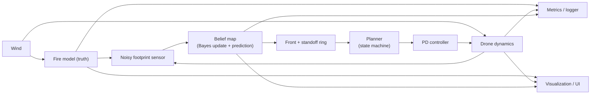

## title: FireScout — Autonomous Wildfire Perimeter Tracking (Simulation) tags: [project, robotics, drone, simulation, python] status: planned created: 2026-10-18

# 🔥 FireScout — Autonomous Wildfire Perimeter Tracking

> [!abstract] One-line pitch A simulated drone that **finds** a spreading wildfire, **estimates** where its front is from a small noisy sensor, and **keeps tracking it safely**, shown in a live interactive demo with measured performance.

**Legend:** 🟢 essential · 🟡 optional · 🔴 boss level (hard, optional) · ⏱ one session ≈ 1 hour

## How to use this document

1. Work through the sessions in **[[#F. Week-by-week development plan]]** in order.
2. Read only the math you need for the session ahead (**[[#C. Mathematical foundations]]**).
3. Try every exercise and challenge **before** opening the folded answers or asking for help.
4. Sessions S1–S14 (🟢) produce the MVP. Everything after is extension.
5. If you fall behind, cut in this order: bosses → extras in S12 → S9 (keep the simple version). Never cut S13 (metrics).

## Table of contents

- [[#A. Project overview]]
- [[#B. Project architecture]]
- [[#C. Mathematical foundations]]
- [[#D. Programming knowledge]]
- [[#E. Learning resources]]
- [[#F. Week-by-week development plan]]
- [[#G. Coding challenges]]
- [[#H. Testing and validation]]
- [[#I. GitHub portfolio]]
- [[#J. Future extensions]]
- [[#K. Final completion checklist]]

---

## A. Project overview

### Decisions from the interview

|Topic|Your choice|Consequence|
|---|---|---|
|Mission|Track the perimeter of a moving wildfire|Moving target → estimation + control|
|Drone realism|2D point mass with inertia and drag|Real feedback control (PD/PID) at low cost|
|Phenomenon|Wildfire as a stochastic cellular automaton with wind|Easy to build, rich to analyze|
|Perception|Small noisy footprint sensor + estimation|Bayes filter, belief map|
|Orientation|Product-oriented|Polished interactive demo, plus a few metrics for credibility|
|Demo|Live desktop window (click to ignite, change wind)|Event loop and UI work|
|Difficulty|Core + weekly boss levels|Essential path fits ~14 h; bosses optional|

### Project card

- **Name:** FireScout
- **Main objective:** build a drone agent that (1) searches an unknown map, (2) detects a fire, (3) maintains an estimate of the fire's perimeter from partial noisy observations, and (4) flies around that perimeter at a safe standoff distance.
- **Real-world motivation:** fire agencies need an up-to-date fire perimeter to plan the response, and aerial infrared mapping is one way to get it. An autonomous agent could shorten the delay and keep people out of danger. _This project is a simplified simulation. It is not an operational system and makes no claim about real fires._
- **Expected final result:** a desktop app showing a 120×120 map where a fire spreads under adjustable wind. The drone searches, finds, then tracks it. Togglable overlays show the truth, the drone's belief, the estimated front, and the sensor footprint. A heads-up display shows live metrics, and a headless benchmark script produces result plots.
- **Main technical challenges:**
    - the drone must be **faster than the fire**, or tracking is impossible;
    - the sensor sees only a small noisy patch, so the world is **partially observable**;
    - the target is **non-stationary**, so observations go stale;
    - **exploration vs tracking** trade-off;
    - controller tuning with actuator limits;
    - evaluating a **stochastic** system fairly.
- **Skills you will develop:** numerical integration, feedback control, stochastic models, Bayesian estimation, decision-making under uncertainty, NumPy vectorization, interactive visualization, testing, experimental evaluation, project documentation.
- **Why it's interesting from an engineering view:** it is a complete _sense → estimate → decide → act_ loop in miniature, with partial observability and a moving target. You already integrated ODEs for orbiting planets. Here the same ideas (time-stepping, stability) reappear in a system with friction, control, and noise.

### Why this project

- every module is small enough to finish in 1–3 sessions;
- it uses your math (ODEs, damping, probability) in a way you can _see_;
- it has a real engineering question: _how do I keep tracking something I can only see through a keyhole?_;
- extensions (Kalman, forecasting, multi-drone, RL) are natural later steps, so it is not a dead end.

---

## B. Project architecture



> [!important] Golden rule **The truth never leaks into the planner.** The planner sees only the belief map and the drone's own state. The truth goes to the sensor (which adds noise), the metrics, and the debug overlay.

### Main loop (one tick)

```text
for each drone step (dt = 0.05 s):
    if step % K == 0:                      # fire runs slower than the drone
        fire.step(wind, rng)               # truth evolves (1 fire tick = 0.5 s)
        belief.predict(wind)               # prior for the new tick
    z = sensor.observe(fire.affected, drone.pos, rng)
    belief.update(z, footprint)            # Bayes
    front, ring = extract_front(belief)
    target = planner.choose(ring, belief, age, drone)
    u = controller.command(drone, target)
    drone.step(u, wind, dt)
    metrics.log(...)
```

### Components

|Module|Responsibility|Inputs → Outputs|Session|
|---|---|---|---|
|`world.py`|Grid, state encoding, coordinates|size → arrays|S1|
|`fire.py`|Stochastic spread with wind|state, wind, rng → new state|S2–S3|
|`drone.py`|Point-mass dynamics|state, thrust, wind → new state|S4|
|`controller.py`|PD (+ optional I) toward waypoint|state, target → thrust|S5|
|`sensor.py`|Footprint + noise|truth, pose → readings|S7|
|`belief.py`|Log-odds map, prediction, age map|readings → belief|S8–S9|
|`front.py`|Front mask and standoff ring|belief → masks|S10|
|`planner.py`|State machine + waypoint scoring|belief, age, pose → waypoint|S11|
|`ui.py`|pygame window, overlays, input|everything → pixels|S1, S12|
|`metrics.py`|Logging and metric computation|everything → CSV|S13|

### Design conventions

- **Coordinates:** world `(x, y)` with `x = column`, `y = row`; unit = 1 cell. This is a classic source of bugs, so test it in S1.
- **Time scales:** drone `dt = 0.05 s`; one fire tick every `K = 10` drone steps (0.5 s).
- **Randomness:** one seeded `numpy.random.Generator` passed explicitly everywhere. No global randomness.
- **Separation:** the simulation core must run **headless** (no pygame import). The UI is a thin layer on top.

### Starting parameters (tune later)

|Parameter|Value|Note|
|---|---|---|
|Grid|120×120|6 px per cell → 720 px window|
|Fire|`p0 = 0.3`, burn time `T_b = 3`, wind gain `α = 0.25`|see [[#C3 — Fire spread (stochastic cellular automaton) 🟢]]|
|Wind|speed `V ∈ [0, 3]`, direction `φ`|adjustable live|
|Drone|`m = 1`, `c = 0.5`, `u_max = 3`|top speed `u_max / c = 6` cells/s|
|Fire front speed|≈ 1–1.5 cells/s|drone ≈ 4–5× faster|
|Sensor|radius `R = 6`, `p_d = 0.9`, `p_f = 0.1`||
|Standoff|`d* = 3`|must stay `< R` so the front is visible|

---

## C. Mathematical foundations

> [!tip] How to use this section Each block gives **why → equations → physical meaning → example → exercise**. Do the exercise on paper first. Folded answers give only _numbers to check against_, not derivations.

### C1 — Drone dynamics (Newton + drag + wind) 🟢

**Why.** The drone cannot teleport. It has inertia, so it needs a controller that anticipates. Planning speed and safe standoff depend on how fast it can really move.

$$m,\ddot{\mathbf{x}} = \mathbf{u} - c,(\dot{\mathbf{x}} - \mathbf{w}), \qquad \lVert \mathbf{u}\rVert \le u_{max}$$

**Meaning.** $\mathbf{u}$ is the thrust you command. Drag pulls the drone toward the _wind velocity_ $\mathbf{w}$ (it acts on the **relative** velocity). In 1D with constant $u$ and no wind:

$$v(t) = v_\infty + (v_0 - v_\infty),e^{-t/\tau}, \qquad v_\infty = \frac{u}{c}, \quad \tau = \frac{m}{c}$$

**Discretization (semi-implicit Euler):**

$$\mathbf{v}_{k+1} = \mathbf{v}_k + \frac{\Delta t}{m}\Big(\mathbf{u}_k - c(\mathbf{v}_k - \mathbf{w})\Big), \qquad \mathbf{x}_{k+1} = \mathbf{x}_k + \Delta t,\mathbf{v}_{k+1}$$

**Example.** $m=1,\ c=0.5,\ u=1$: $v_\infty = 2$, $\tau = 2$ s, and from rest $v(2\text{ s}) = 2(1-e^{-1}) \approx 1.26$.

> [!question] Exercise C1 (a) With $u=0$ and _explicit_ Euler, $v_{k+1} = (1 - c\Delta t/m),v_k$. For which $\Delta t$ is it stable? For which is the decay monotone (no sign flips)? (b) Simulate with $\Delta t = 0.1$ and $0.05$ and compare to the exact solution. How does the error scale with $\Delta t$?

> [!success]- Check your answers (try first) (a) Stable if $\Delta t < 2m/c$; monotone if $\Delta t < m/c$. (b) The error roughly halves when $\Delta t$ halves (first order).

---

### C2 — Feedback control (PD and PID) 🟢

**Why.** You command a _force_, but you want to reach a _position_. Feedback converts position error into force.

With $u = K_p,(x_{ref} - x) - K_d,\dot{x}$ in 1D and no wind:

$$m\ddot{x} + (c + K_d),\dot{x} + K_p,x = K_p,x_{ref}$$

$$\omega_n = \sqrt{\frac{K_p}{m}}, \qquad \zeta = \frac{c + K_d}{2\sqrt{m,K_p}}$$

**Meaning.** It is a spring ($K_p$) plus a damper ($c + K_d$). $\zeta<1$ oscillates, $\zeta=1$ is the fastest response without overshoot, $\zeta>1$ is sluggish. For $\zeta<1$: overshoot $%OS = 100,e^{-\pi\zeta/\sqrt{1-\zeta^2}}$, and 2 % settling time $\approx 4/(\zeta\omega_n)$. At $\zeta=1$ it is $\approx 5.8/\omega_n$.

**Example.** $m=1,\ c=0.5$, target $\omega_n=2,\ \zeta=1$: $K_p = m\omega_n^2 = 4$ and $K_d = 2\zeta\omega_n m - c = 3.5$.

**Wind.** With constant wind $\mathbf{w}$ the drone settles _downwind_ of the target. An integral term removes this: $u \mathrel{+}= K_i\int e,dt$ (needs anti-windup).

> [!question] Exercise C2 (a) Derive the steady-state error under constant wind $w$. Compute it for $c=0.5,\ w=3,\ K_p=4$. (b) With $u_{max}=3$ and a 20-cell step, predict whether the "$\zeta=1$" design overshoots. Then simulate. What assumption of the linear design is violated? (c) Why is an integral term dangerous when the actuator saturates?

> [!success]- Check your answers (try first) (a) $e_{ss} = c,w/K_p = 0.375$ cells. (b) Saturation makes the system nonlinear: the design assumed unlimited force. A common fix is to limit the commanded speed. (c) The integrator keeps accumulating while the actuator can't respond (windup), then overshoots.

---

### C3 — Fire spread (stochastic cellular automaton) 🟢

**Why.** You need a spreading target that is random, wind-biased, and cheap to simulate.

Cells are _unburnt (0), burning (1), burnt (2)_. A burning cell tries to ignite each of its 4 neighbors every tick. A cell burns for $T_b$ ticks, then becomes burnt.

$$p_{n\leftarrow b} = \min!\Big(1,; p_0,e^{\alpha V \cos\theta_{bn}}\Big), \qquad P(\text{ignite } n) = 1 - \prod_{b\in\mathcal{B}(n)}\big(1 - p_{n\leftarrow b}\big)$$

$\theta_{bn}$ is the angle between the wind direction and the direction from $b$ to $n$. Downwind neighbors ignite more easily, upwind ones less. $\mathcal{B}(n)$ is the set of burning neighbors of $n$.

Without wind, one neighbor burns $T_b$ ticks, so the effective per-edge probability is:

$$p_{\text{eff}} = 1 - (1-p_0)^{T_b}$$

**Example.** Two burning neighbors with $p=0.3$: $1 - 0.7^2 = 0.51$. With $p_0=0.3,\ T_b=3$: $p_{\text{eff}} = 0.657$.

> [!warning] Parameter trap If $p_{\text{eff}}$ is near or below $0.5$, the fire often **dies out** by itself. Stay well above $0.5$.

> [!question] 🔴 Boss B1 (week 1): percolation With $T_b=1$, $V=0$, 4 neighbors, the process behaves like **bond percolation** on a square lattice, with critical probability $p_c = 1/2$. Simulate the final burnt fraction vs $p_0$ on a 200×200 grid, averaged over seeds. Do you see a sharp transition near $0.5$? Why does $p_0=0.3$ die out with $T_b=1$ but not with $T_b=3$?

---

### C4 — Bayesian sensing (log-odds belief map) 🟢

**Why.** The sensor lies sometimes. You need to combine many noisy readings into a belief.

State per cell: $s\in{0,1}$ (1 = affected by fire). Sensor model: $P(z{=}1\mid s{=}1)=p_d$ and $P(z{=}1\mid s{=}0)=p_f$. Bayes' rule for a cell with prior $b$:

$$b' = \frac{P(z\mid 1),b}{P(z\mid 1),b + P(z\mid 0),(1-b)}$$

Equivalently, in **log-odds** $\ell = \ln\frac{b}{1-b}$, updates become additions:

$$\ell' = \ell + \ln\frac{P(z\mid 1)}{P(z\mid 0)}$$

**Meaning.** Each reading adds or subtracts a fixed amount of evidence. With $p_d=0.9,\ p_f=0.1$: $\ln 9 \approx 2.2$ per "fire" reading, $-2.2$ per "no fire" reading. This is the same update as an _occupancy grid_ in robotics.

**Example.** $b=0.2,\ z=1$: $b' = \frac{0.9\cdot0.2}{0.9\cdot0.2+0.1\cdot0.8} = 0.692$. With $z=0$: $b' = 0.027$.

> [!question] Exercise C4 (a) Derive the log-odds form from Bayes' rule. (b) Starting from $b=0.5$, how many consecutive $z=1$ readings are needed for $b\ge 0.99$? (c) Why clip $\ell$ to about $\pm10$? (d) What happens if $p_f \ge p_d$?

> [!success]- Check your answers (try first) (b) 3 readings ($\ln 99 \approx 4.6$ needed, each adds $\approx 2.2$). (c) At $b=0$ or $1$ the log-odds are infinite and the cell can never change its mind, but fire _spreads_. (d) The likelihood ratio is $\le 1$, so the sensor carries no useful information.

---

### C5 — Prediction step (hazard from neighbors) 🟢

**Why.** The fire moves while the drone isn't looking. Without prediction, belief ahead of the front stays "safe" and goes stale.

Let $b_t(c)$ be the probability that cell $c$ is affected. A mean-field prediction (neighbors treated as independent):

$$b^-_{t+1}(c) = b_t(c) + \big(1 - b_t(c)\big)\Big[,1 - \prod_{n\in\mathcal{N}(c)}\big(1 - p_{n\to c},b_t(n)\big)\Big]$$

**Meaning.** The chance that an unaffected cell ignites is the chance that _at least one_ neighbor is on fire and transmits. Belief therefore creeps outward ahead of the known front. _Approximations:_ neighbors are independent and burn-out is ignored. Name these as limitations in your README.

**Example.** $b(c)=0.1$, two neighbors with $b=1$, $p=0.3$: $b^- = 0.1 + 0.9\cdot0.51 = 0.559$.

> [!question] Exercise C5 Show that $b^-\ge b$ always, and $b^-=b$ when every neighbor has $b=0$. What does this say about the shape of belief over time if the drone never looks at a region?

---

### C6 — Information and decision-making 🟢

**Why.** Where should the drone go next? Toward the places where it knows least _and_ that matter.

Binary entropy and a waypoint score:

$$H(b) = -b\ln b - (1-b)\ln(1-b), \qquad J(c) = H(b_c) + \beta,\text{age}_c - \lambda,\lVert \mathbf{x}_c - \mathbf{x}_{drone}\rVert$$

**Meaning.** $H$ is maximal at $b=\tfrac12$ (the front: "maybe fire, maybe not"). $\text{age}_c$ is the time since $c$ was last observed. $\lambda$ is the cost of travel. $\beta$ is the pressure to revisit stale areas.

**Example.** $H(0.5) = \ln 2 = 0.693$ nats. $H(0.9) = 0.325$ nats.

> [!question] Exercise C6 (a) Prove $H$ is maximal at $b=\tfrac12$. (b) If the drone hovers in place, how do ages evolve inside and outside its footprint? (c) What goes wrong if $\lambda=0$? If $\beta=0$?

---

### C7 — Geometry (front extraction and standoff ring) 🟢

**Why.** The planner needs _places to fly to_, not a heat map.

Let $A={c: b_c\ge 0.5}$ be the estimated affected region.

$$F = {c\in A : \exists, n\in\mathcal{N}_4(c),\ n\notin A}, \qquad D(c) = \min_{a\in A}\lVert c - a\rVert, \qquad \text{ring} = {c : d^_-\tfrac12 \le D(c) < d^_+\tfrac12}$$

**Meaning.** $F$ is the estimated fire perimeter. The ring is the set of cells at standoff distance $d^_$: close enough that the front stays inside the sensor footprint ($d^_ < R$), far enough to stay out of the heat.

**Example.** A single affected cell and $d^*=2$ → the ring has **12** cells.

> [!question] Exercise C7 Verify the 12 by hand (count lattice points with $2.25\le x^2+y^2<6.25$). Why must $d^_<R$? What can go wrong if $d^_$ is too small?

---

### C8 — Statistics for evaluation 🟢

**Why.** A stochastic simulation makes any single run meaningless.

$$\bar{x} \pm 1.96,\frac{s}{\sqrt{n}}, \qquad d_i = x_i^{A} - x_i^{B}\ \ (\text{same seed } i)$$

**Meaning.** The first expression is a 95 % confidence interval of the mean. The second is a _paired_ difference: both algorithms face the same random fire, which removes scenario noise.

**Example.** $n=30,\ s=2.0$ → half-width $= 1.96\cdot2/\sqrt{30} = 0.72$.

> [!question] Exercise C8 How many runs do you need to halve the CI width? Why is a paired comparison more powerful than comparing two independent batches?

---

### 🔴 Boss-level mathematics (optional)

**B2 — Information-gain planner (week 2).** Replace $H(b_c)+\beta,\text{age}_c$ with the _expected reduction in entropy_ of the cells a candidate waypoint would reveal:

$$\mathbb{E}\big[\Delta H\big] = H(b) - \sum_{z\in{0,1}} P(z),H(b'_z)$$

Compare with your simple score using the C7-style benchmark.

**B3 — Kalman filter for the drone state (week 3).** The drone's own position comes from noisy GPS:

$$\hat{x}^-_k = F\hat{x}_{k-1} + Bu_k,\quad P^-_k = FP_{k-1}F^{\top}+Q$$ $$K_k = P^-_kH^{\top}\big(HP^-_kH^{\top}+R\big)^{-1},\quad \hat{x}_k = \hat{x}^-_k + K_k,(z_k - H\hat{x}^-_k),\quad P_k = (I-K_kH)P^-_k$$

**B4 — Continuum limit and elliptical front (week 4).** Your CA front behaves like a traveling wave. In a continuum model $\partial_t u = D\nabla^2 u + r,u(1-u)$ the minimal front speed is $v = 2\sqrt{Dr}$ (Fisher–KPP). With wind, front propagation can be modeled by the level-set equation

$$\partial_t\phi + R(\mathbf{n}),\lVert\nabla\phi\rVert = 0$$

where $R$ is the normal spread rate. Huygens-style growth makes wind-driven fire spread in an **ellipse**. Measure the length-to-width ratio of your simulated burn scar vs wind speed.

---

## D. Programming knowledge

Python is the main language. Statuses below are my defaults, so reclassify them honestly against your own level.

|Concept / tool|Status|Used in|
|---|---|---|
|Functions, loops, algorithms, Git/GitHub, Linux terminal|✅ Known|everywhere|
|Classes and `dataclass` (drone state, params)|🔁 Revise|S4, S11|
|Virtual environments (`venv`), `pip`|🔁 Revise|S1|
|`pytest` (fixtures, parametrize, approx)|🔁 Revise|S2 onward|
|**NumPy**: arrays, broadcasting, slicing, boolean masks|🆕 Learn|S1–S10|
|**Vectorization** (no Python loop over cells)|🆕 Learn|S2, S3, S8, S9|
|Shifting arrays with padding (not `np.roll`)|🆕 Learn|S2, S9|
|`numpy.random.default_rng(seed)`|🆕 Learn|S2|
|`scipy.ndimage`: distance transform, dilation, labeling|🆕 Learn|S10|
|**pygame**: event loop, drawing, input|🆕 Learn|S1, S12|
|State machine pattern|🆕 Learn|S11|
|CSV logging, `pandas` basics|🆕 Learn|S13, S16|
|`matplotlib` plots (offline analysis)|🔁 Revise|S5, S17|
|`cProfile` / timing|🆕 Learn|S6|

**Install (WSL/Linux):**

```bash
python3 -m venv .venv && source .venv/bin/activate
pip install numpy scipy matplotlib pygame pytest pandas
```

> [!warning] GUI on WSL pygame windows need **WSL2 with WSLg** (Windows 11). If no window appears, run the UI with native Windows Python and keep the headless sim/tests in WSL. The sim core has no pygame import, so both work.

**Where C could matter 🟡:** only in S22. Rewrite the fire step in C, call it from Python with `ctypes`, and compare the timing against your NumPy version. It is a good moment to connect your C knowledge to a real performance question. It is not needed for the MVP.

---

## E. Learning resources

> [!note] About links I only list links I know exist. Papers are cited by author and title, so search the exact title on Google Scholar. ⭐ = core (≈2 h in total). Everything else is optional or a skim.

||Resource|Study this|Why it matters|Needed in|Time|
|---|---|---|---|---|---|
|⭐|[NumPy: absolute beginners](https://numpy.org/doc/stable/user/absolute_beginners.html)|Arrays, slicing, boolean masks, broadcasting|Everything is vectorized|S1–S3|20 min|
|⭐|[pygame docs](https://www.pygame.org/docs/)|Display, event loop, `draw`, `Surface`|Interactive demo|S1, S12|20 min|
|⭐|Brian Douglas, _Control Systems Lectures_ (YouTube channel, search "Brian Douglas PID")|What P, I, D each do|Intuition before the equations|S5|30 min|
|⭐|[Kalman and Bayesian Filters in Python](https://github.com/rlabbe/Kalman-and-Bayesian-Filters-in-Python) (R. Labbe)|The early chapters on discrete Bayes filters|The belief update is a discrete Bayes filter|S8|30 min|
|⭐|Karafyllidis & Thanailakis (1997), _A model for predicting forest fire spreading using cellular automata_, Ecological Modelling|Skim the model definition|Where CA fire models come from|S2|20 min|
|🟡|[Åström & Murray, _Feedback Systems_](https://fbswiki.org/)|Chapters on dynamic behavior and PID|Rigorous version of C2|S5|30 min|
|🟡|[MIT OCW 18.03 Differential Equations](https://ocw.mit.edu/courses/18-03-differential-equations-spring-2010/)|Second-order linear ODEs and damping|Refresher for C1–C2|S4–S5|30 min|
|🟡|[MIT OCW 6.041 Probabilistic Systems Analysis](https://ocw.mit.edu/courses/6-041-probabilistic-systems-analysis-and-applied-probability-fall-2010/)|Bayes' rule, independence|Refresher for C4–C5|S8|30 min|
|🟡|Thrun, Burgard, Fox, _Probabilistic Robotics_ (MIT Press)|Chapter on occupancy grid mapping|Your belief map _is_ a log-odds occupancy grid|S8|45 min|
|🟡|[SciPy `ndimage` docs](https://docs.scipy.org/doc/scipy/reference/ndimage.html)|`distance_transform_edt`, `binary_dilation`, `label`|Front and ring extraction|S10|15 min|
|🟡|[pytest docs](https://docs.pytest.org/)|Fixtures, `parametrize`, `pytest.approx`|Testing a stochastic sim|S2|15 min|
|🟡|[PythonRobotics](https://github.com/AtsushiSakai/PythonRobotics)|Read the path-tracking and Kalman filter code for style. **Don't copy.**|See how others structure robotics code|S5, S19|30 min|
|🟡|[bzarg: Kalman filter in pictures](https://www.bzarg.com/p/how-a-kalman-filter-works-in-pictures/)|The geometric intuition|Boss B3|S19|20 min|
|🟡|Casbeer et al. (2006), _Cooperative forest fire surveillance using a team of small unmanned air vehicles_, Int. J. Systems Science|Intro and problem setup|Real research on your exact problem|S15|20 min|
|🟡|Rothermel (1972), USDA Forest Service Research Paper INT-115|Reference only|The classic physical fire-spread model|J|—|
|🟡|[matplotlib animation docs](https://matplotlib.org/stable/api/animation_api.html)|`FuncAnimation`, saving GIFs|Quick demo clips|S14|15 min|

---

## F. Week-by-week development plan

**Reality check.** 14 sessions = 14 hours, which is the minimum for the MVP. If you miss days, the MVP simply finishes in week 3. That's fine. Don't compress sessions.

|Week|Sessions|Milestone|
|---|---|---|
|1|S1–S7 🟢|Interactive world: fire spreading under wind, drone with inertia and a PD controller, noisy sensor|
|2|S8–S14 🟢|**MVP v0.1:** drone searches, finds, and tracks the fire, live demo with metrics and a README|
|3|S15–S18 🟡|Baselines, benchmark runner, statistical comparison|
|4|S19–S24 🟡/🔴|Kalman, forecasting, polish, technical report|

Boss levels: 🔴 **W1** B1 percolation · 🔴 **W2** B2 information-gain planner · 🔴 **W3** B3 Kalman filter · 🔴 **W4** B4 continuum limit / elliptical front.

---

### Week 1 — Build the world 🟢

#### 🟢 S1 — Environment and world

- **Objective:** repo, virtual environment, and a window showing the 120×120 grid.
- **Concepts:** game loop (events → update → draw), `uint8` state encoding, coordinate convention (`x = column`, `y = row`).
- **Math:** none.
- **Programming task:** `git init`, venv, `world.py` (grid array), `ui.py` (draw cells at 6 px, ESC quits, mouse hover prints the cell).
- **Expected output:** a green forest window.
- **Verification:** a test of grid shape and dtype. Click the four corners and check that the printed `(x, y)` matches what you see.
- **Done when:**
    - [ ] window runs at a steady frame rate
    - [ ] coordinate convention tested
    - [ ] first commit pushed with a README stub

#### 🟢 S2 — Fire step v1 (no wind)

- **Concepts:** cellular automaton, **synchronous** update, seeded RNG, padding vs `np.roll`.
- **Math:** [[#C3 — Fire spread (stochastic cellular automaton) 🟢]] (ignition formula).
- **Programming task:** solve **[[#CH1 — fire_step|Challenge CH1]]** without wind. Click to ignite.
- **Expected output:** a fire spreading as a blob (a diamond when `p = 1`).
- **Verification:** CH1 tests 1–3.
- **Done when:**
    - [ ] tests green
    - [ ] fire burns out cleanly
    - [ ] same seed → identical run

#### 🟢 S3 — Wind

- **Concepts:** direction-dependent probabilities, vectorization.
- **Math:** the wind factor $e^{\alpha V\cos\theta}$ in C3.
- **Programming task:** add `V` and `φ`. Arrow keys change direction and speed. Show a wind arrow.
- **Expected output:** a fire elongated downwind.
- **Verification:** CH1 test 4. Statistical check: over 20 seeds, mean downwind extent > mean upwind extent.
- **Done when:**
    - [ ] wind visibly biases the fire
    - [ ] `V = 0` is statistically symmetric
- 🔴 _Boss B1 (optional, ~1 h):_ percolation experiment from C3.

#### 🟢 S4 — Drone dynamics

- **Concepts:** ODE integration, saturation, fixed time step independent of frame rate.
- **Math:** C1.
- **Programming task:** solve **Challenge CH2**. Drive the drone with keyboard thrust.
- **Expected output:** a triangle that visibly has inertia and drag. Wind pushes it.
- **Verification:** CH2 tests (terminal velocity, exponential decay, norm saturation).
- **Done when:**
    - [ ] CH2 tests green
    - [ ] you can feel the inertia

#### 🟢 S5 — PD controller

- **Concepts:** feedback, damping ratio, saturation, derivative on measurement.
- **Math:** C2 (design $K_p, K_d$ for $\zeta=1$).
- **Programming task:** solve **Challenge CH3**. Fly to the mouse click. A separate script plots the step response with matplotlib.
- **Expected output:** smooth flight to the target.
- **Verification:** predicted vs measured overshoot and settling time. Steady-state error under wind vs $c,w/K_p$.
- **Done when:**
    - [ ] design matches simulation
    - [ ] you can explain any gap between them
- 🟡 _Optional:_ add an integral term with anti-windup and show it removes the wind offset.

#### 🟢 S6 — Integration and heat zone

- **Concepts:** two time scales, determinism, profiling.
- **Math:** none.
- **Programming task:** one main loop (fire tick every `K = 10` drone steps). Define the **heat zone** = burning cells dilated by 2. Count the ticks the drone spends inside it.
- **Expected output:** manual flight near a live fire.
- **Verification:** same seed → same fire evolution regardless of drone motion. FPS ≥ 30 (profile with `cProfile` if not).
- **Done when:**
    - [ ] decoupled and deterministic
    - [ ] heat-zone counter works

#### 🟢 S7 — Sensor model

- **Concepts:** footprint mask (disk), Bernoulli noise, separating truth from observation.
- **Math:** the likelihood in C4 ($p_d, p_f$).
- **Programming task:** `sensor.py` with `observe(truth, pos) → (mask, readings)`. Overlay the footprint and readings.
- **Expected output:** a circle under the drone with flickering noisy detections.
- **Verification:** with `p_d = 1, p_f = 0` readings equal the truth. Empirical rates over $10^5$ samples within ±0.5 % of $p_d$ and $p_f$.
- **Done when:**
    - [ ] statistical test green
    - [ ] **week-1 milestone reached:** commit and tag `week1`

---

### Week 2 — Intelligence and MVP 🟢

#### 🟢 S8 — Belief map

- **Concepts:** log-odds, evidence accumulation, clipping.
- **Math:** C4.
- **Programming task:** solve **Challenge CH4**. Overlay a belief heat map. Initial prior ≈ 0.02 per cell.
- **Expected output:** hover over a static fire and watch belief rise inside the footprint.
- **Verification:** numeric tests (0.692 and 0.027). On a _static_ fire the belief converges to the truth. Cells outside the footprint never change.
- **Done when:**
    - [ ] static-fire convergence test green

#### 🟢 S9 — Prediction and age map

- **Concepts:** mean-field approximation, staleness.
- **Math:** C5.
- **Programming task:** implement $b^-$ with shifted arrays. Add an `age` map (reset to 0 inside the footprint, +1 elsewhere).
- **Expected output:** belief creeps outward ahead of the front when the drone looks away.
- **Verification:** $b^- \ge b$ everywhere, and unchanged if no neighbor is affected. The example gives 0.559.
- **Done when:**
    - [ ] invariants tested
    - [ ] you can state both approximations aloud

#### 🟢 S10 — Front and standoff ring

- **Concepts:** morphology, distance transform, connected components.
- **Math:** C7.
- **Programming task:** solve **Challenge CH5**. Overlay the estimated front (and the true front in debug mode).
- **Expected output:** a clean outline around the estimated fire, plus a ring at `d* = 3`.
- **Verification:** synthetic tests (16-cell perimeter, 12-cell ring).
- **Done when:**
    - [ ] tests green
    - [ ] speckle removed with a minimum-size filter

#### 🟢 S11 — Planner v1 (state machine)

- **Concepts:** finite state machine, hysteresis, exploration vs exploitation.
- **Math:** C6.
- **Programming task:** states **SEARCH** (lawnmower with lane spacing ≈ $1.8R$) and **TRACK** (choose a ring waypoint with **Challenge CH6**). Switch SEARCH → TRACK when at least $N_{min}$ cells have $b\ge 0.8$. Switch back if the estimated region disappears.
- **Expected output:** the drone finds a fire it was never told about and circles it.
- **Verification:** 20 random ignitions: detection within `T_max` in ≥ 90 % of runs. Heat-zone time stays small.
- **Done when:**
    - [ ] it works from random starts
    - [ ] no dithering between waypoints
- 🔴 _Boss B2 (optional):_ information-gain scoring.

#### 🟢 S12 — Interactive UX

- **Programming task:** click to ignite, wind keys, pause/step, reset with seed, overlay toggles (truth / belief / front / footprint), HUD (state, time, tracking error).
- **Expected output:** a demo you can show anyone in 10 seconds.
- **Verification:** use it for 5 minutes without a crash.
- **Done when:**
    - [ ] all controls listed in the README
    - [ ] 🟡 extras cut first if you are behind

#### 🟢 S13 — Metrics and headless mode

- **Concepts:** logging, reproducibility, separating sim from UI.
- **Math:** metrics from [[#H. Testing and validation]].
- **Programming task:** `metrics.py` (tracking error, front coverage, belief F1, Brier score, distance, heat ticks) and a CSV per run. Add `--headless`.
- **Expected output:** one CSV row per run.
- **Verification:** a headless run equals a GUI run with the same seed.
- **Done when:**
    - [ ] determinism proven
    - [ ] metrics sanity-checked on a hand-made case

#### 🟢 S14 — MVP freeze, demo, README v1

- **Programming task:** fix bugs only, no features. Record a 60–90 s demo. Write README v1 with an honest limitations section. Tag `v0.1`.
- **Done when:**
    - [ ] a stranger can clone and run it in under 5 minutes
    - [ ] **MVP milestone reached**

---

### Weeks 3–4 — Extension 🟡/🔴

|Session|Objective|Concepts / math|Task|Expected output|Verification|Done when|
|---|---|---|---|---|---|---|
|🟡 S15|Baselines|policy interface|Implement: _lawnmower-only_, _random waypoints_, _oracle_ (uses the truth, upper bound), and your planner|4 policies behind one `Policy` interface|Oracle ≥ yours ≥ random on a few runs|Policies swap with one flag|
|🟡 S16|Benchmark runner|seeds, scenarios|Headless batch over seeds × policies × scenarios (low/high wind), with `multiprocessing`|`results.csv`|Same seed + policy → identical row|30+ seeds per cell, reproducible|
|🟡 S17|Statistical analysis|C8, paired Wilcoxon|`analyze.py`: mean ± 95 % CI, paired tests, box plots|`docs/results.md` with plots|Identical policies → difference exactly 0|Claims backed by numbers|
|🟡 S18|Sensitivity|speed ratio, $p_d, p_f$|Sweep drone speed vs fire speed, and sensor quality|Plot of tracking error vs ratio|Find the "can't keep up" threshold|Threshold identified and explained|
|🔴 S19|**Boss B3:** Kalman filter|state estimation|Noisy GPS → KF → controller uses estimate|Smoother flight under noise|Estimate error < raw GPS error|Compare control with truth vs estimate|
|🔴 S20|**Boss B4:** forecast ensemble|Monte Carlo|Run $K$ short fire simulations from the belief to forecast the front|Planner aims where the front _will be_|Tracking error improves in benchmark|Gain measured with CI|
|🟡 S21|Robustness|model mismatch|Planner designed for $p_0=0.3$, test on other $p_0$ and wind|Robustness plot|Degradation quantified|Failure modes listed|
|🟡 S22|Performance (C moment)|profiling, `ctypes`|Rewrite `fire_step` in C and call from Python|Timing table NumPy vs C|Outputs match NumPy for same seeds|Speedup reported honestly|
|🟡 S23|Safety|potential field|No-fly zones or smoke patches to avoid|Avoidance behavior|Zero violations in 30 runs|Documented|
|🟡 S24|Report and release|writing|4–6 page technical write-up and final demo video; tag `v1.0`|PDF/MD report|Peer-readable|Release published|
|⚪ S25–S28|Buffer||Catch-up, polish, bug-fixing||||

---

## G. Coding challenges

> [!important] Rules Solve each challenge **alone first**. Run the tests. Only then compare with a reference or ask me to review your attempt. A failing test you understand is worth more than a passing copy-paste.

### CH1 — fire_step

- **Problem:** write `fire_step(state, timer, wind, params, rng) → (state, timer)`, one synchronous tick of the fire automaton.
- **Input / output:** `state`: `uint8` array in {0 unburnt, 1 burning, 2 burnt}; `timer`: `int` array of remaining burn ticks; `wind = (V, φ)`; `params = (p0, α, T_b)`. Returns new arrays.
- **Constraints:** no Python loop over cells. A 120×120 step runs in well under 5 ms. Synchronous update (read old state, write new). Deterministic for a given `rng`.
- **Mathematical hints:** the wind makes $p$ depend only on the **direction** (N/E/S/W), so it is a scalar per direction. Ignition probability is $1-\prod(1-p_d)$ over burning neighbors.
- **Algorithmic hints:** for each direction, shift the "burning" mask by one cell **with padding**. Combine the four shifted masks into one ignition probability per cell. Draw **one** uniform number per cell and compare.
- **Expected behavior:** burning cells count down and become burnt. Burnt cells never reignite.
- **Test cases:**
    1. `p = 0` → nothing new ignites.
    2. `p = 1, T_b = 1`, single ignition at the center, after 5 ticks the affected set is the Manhattan ball $\lvert dx\rvert+\lvert dy\rvert \le 5$ with **61** cells.
    3. Same seed → identical arrays.
    4. Strong east wind → mean $x$ of affected cells > the ignition $x$.
- **Common mistakes:** `np.roll` wraps around the border (the fire reappears on the other side), in-place updates (directional bias), forgetting the burning → burnt transition, reigniting burnt cells.

### CH2 — drone_step

- **Problem:** write `drone_step(x, v, u, w, m, c, dt, u_max) → (x, v)` using semi-implicit Euler.
- **Input / output:** 2D `numpy` vectors. Returns the new position and velocity.
- **Constraints:** saturate the **norm** of `u`, not each axis. Drag acts on the relative velocity `v - w`.
- **Mathematical hints:** [[#C1 — Drone dynamics (Newton + drag + wind) 🟢|C1]].
- **Algorithmic hints:** update `v` first, then `x` with the **new** `v`.
- **Expected behavior:** exponential approach to terminal velocity. With no thrust, the velocity drifts toward the wind.
- **Test cases** (m=1, c=0.5, dt=0.01):
    1. `u=(1,0)`, `v0=0`, `w=0`: `v(10 s) ≈ 1.9865`.
    2. `u=0`, `v0=(1,0)`: `v(2 s) ≈ 0.368`.
    3. `u=(10,0)`, `u_max=3` → effective thrust norm exactly 3, direction unchanged.
    4. `u=0`, `w=(1,0)`, `v0=0` → `v → (1,0)`.
- **Common mistakes:** large `dt`, per-axis clipping (changes the direction), forgetting that drag uses `v - w`.

### CH3 — pd_controller

- **Problem:** write `pd_command(x, v, target, Kp, Kd, u_max) → u`, and a script that finds gains for $\omega_n=2,\ \zeta=1$ and verifies them by simulation.
- **Input / output:** vectors in, thrust vector out.
- **Constraints:** saturate the norm of `u`. Use the velocity (measurement) for the derivative term, not the derivative of the error.
- **Mathematical hints:** [[#C2 — Feedback control (PD and PID) 🟢|C2]]. Remember that drag adds to the damping.
- **Algorithmic hints:** simulate a 10-cell step and extract overshoot and 2 % settling time from the trajectory.
- **Expected behavior:** for small steps, no overshoot and settling in about $5.8/\omega_n \approx 2.9$ s. For large steps, saturation changes the picture.
- **Test cases:** $K_p=4,\ K_d=3.5$ (with $m=1,\ c=0.5$) → $\zeta \approx 1$. Steady-state error under wind $w=3$ is about $0.375$.
- **Common mistakes:** designing the gains while ignoring $c$, wrong sign on $K_d$, derivative kick on target changes, simulation `dt` too coarse.

### CH4 — update_belief

- **Problem:** write `update_belief(logodds, footprint, z, pd, pf) → logodds`.
- **Input / output:** `logodds` float array; `footprint` boolean mask; `z` boolean array of readings (valid inside the footprint).
- **Constraints:** only footprint cells change. Clip log-odds to ±10.
- **Mathematical hints:** [[#C4 — Bayesian sensing (log-odds belief map) 🟢|C4]]. The evidence is $\ln\frac{p_d}{p_f}$ for $z=1$ and $\ln\frac{1-p_d}{1-p_f}$ for $z=0$.
- **Algorithmic hints:** `np.where` with boolean masks. Convert to probability only for display.
- **Expected behavior:** repeated consistent readings drive belief toward 0 or 1.
- **Test cases:**
    1. `b=0.2, z=1` → `0.692`. `z=0` → `0.027`.
    2. Cells outside the footprint are unchanged.
    3. Three `z=1` readings from `b=0.5` give `b > 0.99` (≈ 0.9986).
- **Common mistakes:** updating cells outside the footprint, mixing probabilities and log-odds, not clipping (then a cell can never recover when the fire spreads), counting the same reading twice.

### CH5 — extract_front

- **Problem:** write `extract_front(belief, thr=0.5, d_star=3, min_size=5) → (front_mask, ring_mask)`.
- **Input / output:** `belief` in [0,1]; two boolean masks out.
- **Constraints:** remove connected components smaller than `min_size`. Don't treat the grid border as a front.
- **Mathematical hints:** [[#C7 — Geometry (front extraction and standoff ring) 🟢|C7]].
- **Algorithmic hints:** `scipy.ndimage.label` for components, `distance_transform_edt` on the **complement** of $A$ for $D(c)$.
- **Expected behavior:** a clean closed outline plus a ring at distance ≈ `d_star`.
- **Test cases:**
    1. A 5×5 filled square inside a 20×20 grid → front has **16** cells.
    2. A single affected cell with `d_star = 2` → ring has **12** cells.
    3. An empty belief → both masks empty.
- **Common mistakes:** giving `distance_transform_edt` the wrong mask (it measures distance to the nearest _zero_), speckle from noisy belief, a front along the map edge.

### CH6 — choose_waypoint

- **Problem:** write `choose_waypoint(ring_cells, belief, age, drone_pos, beta, lam, current) → (x, y)` using $J(c)$.
- **Input / output:** candidate cells, maps, drone position; returns the chosen waypoint.
- **Constraints:** never choose a cell closer than `d* − 1` to the estimated front. Add **hysteresis**: keep the current waypoint until reached or clearly beaten.
- **Mathematical hints:** [[#C6 — Information and decision-making 🟢|C6]].
- **Algorithmic hints:** vectorize the scoring over all ring cells.
- **Expected behavior:** with equal travel cost it prefers the staler cell. With equal staleness it prefers the closer one.
- **Test cases** (equal entropy, β=0.1): candidate A (age 10, distance 5), candidate B (age 30, distance 20). With λ=0.05 → **B** (2.0 vs 0.75). With λ=0.2 → **A** (0 vs −1).
- **Common mistakes:** dithering between two equally good waypoints, forgetting to reset age inside the footprint, waypoints inside the heat zone, mixing units.

### CH7 — benchmark and statistics 🟡

- **Problem:** run $N$ seeds × policies × scenarios headless, then report mean ± CI and a paired test.
- **Input / output:** configs → `results.csv` → `analyze.py` → table and plots.
- **Constraints:** every policy sees the **same seeds**. Split seeds: development 0–99, final test 1000–1099.
- **Mathematical hints:** [[#C8 — Statistics for evaluation 🟢|C8]]. Use `scipy.stats.wilcoxon` on the paired differences.
- **Algorithmic hints:** `multiprocessing.Pool` over (policy, seed) pairs.
- **Expected behavior:** oracle ≥ your planner ≥ random.
- **Test cases:** same seed + policy twice → identical rows. The same policy compared with itself → difference exactly 0. A "do nothing" policy must be significantly worse.
- **Common mistakes:** different seeds per policy (unpaired noise), reporting only means, tuning on the test seeds, fewer than 20 runs, non-deterministic code (wall-clock time, global RNG).

---

## H. Testing and validation

### The test pyramid

|Level|What|Example|
|---|---|---|
|Unit|one function, known answer|CH2 terminal velocity, CH4 numeric update|
|Property|invariants that must always hold|burnt never reignites, belief ∈ [0, 1], $b^-\ge b$|
|Statistical|empirical rates match the model|sensor detection rate within ±0.5 % of $p_d$|
|Regression|fixed seed → fixed result|"seed 7 gives these metrics"|
|Visual|overlays for debugging|truth vs belief vs front|

### Metrics

|Metric|Definition|Tells you|
|---|---|---|
|**Detection time**|ticks from ignition until the first region has $b\ge0.8$|search quality|
|**Tracking error**|$e(t) = \min_{f\in F_{true}(t)}\lVert \mathbf{x}(t)-f\rVert$, reported as RMS of $e - d^*$|how well it holds the standoff|
|**Front coverage**|fraction of true front cells observed within the last $\tau$ ticks|situational awareness|
|**Belief quality**|F1 (or IoU) between ${b\ge0.5}$ and the true affected set; **Brier** score $\frac1N\sum_c (b_c - s_c)^2$|accuracy and calibration|
|**Safety**|ticks inside the heat zone|risk|
|**Distance traveled**|$\int\lVert \mathbf{v}\rVert,dt$|efficiency|
|**Control effort**|$\int\lVert \mathbf{u}\rVert^2,dt$|energy proxy|
|**Compute**|ms per tick (median and 95th percentile)|real-time feasibility|
|**Mission success**|_you define it before running experiments_, for example: detected within `T_max`, mean coverage ≥ 0.6, zero heat-zone ticks|headline number|

> [!tip] Fix the definition of success **before** you look at results. Otherwise you will unconsciously choose the one that flatters your algorithm.

### Comparing algorithms objectively

1. **Baselines:** random waypoints (lower bound), lawnmower-only, **oracle** with truth access (upper bound), your planner. Sanity check: oracle ≥ yours ≥ random.
2. **Paired seeds:** every policy faces the same fires.
3. **Enough runs:** at least 30 per scenario cell. Report mean ± 95 % CI.
4. **Paired test:** Wilcoxon signed-rank on per-seed differences. Report the effect size too, not only a p-value.
5. **Ablations:** remove the prediction step; remove the age term. Whichever removal hurts the most shows what matters.
6. **Honest splits:** tune on development seeds, report on test seeds.
7. **Show distributions** (box plots), not only averages.

### Simulation vs mathematical model vs real robotics

|Layer|What it is|In this project|What it hides|
|---|---|---|---|
|**Mathematical model**|equations that describe reality approximately|$m\ddot{x}=u-c(\dot{x}-w)$, ignition probabilities|everything you left out of the equations|
|**Simulation**|the model run on a computer|your Python code, Euler steps|numerical error, bugs, the model's own assumptions|
|**Real robotics**|physical systems|not in this project|rotor dynamics, attitude, latency, actuator limits, sensor failure, wind gusts, regulation, safety|

_A good simulation result proves the algorithm works **in the model**. It does not prove it works in the world._

### Limitations of the final prototype (write these in your README)

- The fire is a stylized stochastic automaton, not a physical combustion model (no terrain, fuel moisture, spotting, or turbulence).
- The drone is a 2D point mass: no attitude, no altitude, no battery.
- The sensor is binary with independent noise per cell. Real thermal images are correlated and affected by smoke.
- The belief prediction assumes independent neighbors and ignores burn-out.
- Parameters were tuned by hand on a few scenarios.
- The planner is a hand-designed heuristic with no optimality guarantee.

---

## I. GitHub portfolio

### Repository structure

```text
firescout/
├── README.md
├── LICENSE                 # MIT
├── pyproject.toml          # or requirements.txt
├── src/firescout/
│   ├── world.py  fire.py  drone.py  controller.py  sensor.py
│   ├── belief.py  front.py  planner.py  metrics.py
│   ├── ui.py     main.py
├── tests/                  # pytest: unit, property, statistical, regression
├── experiments/
│   ├── run_benchmark.py  analyze.py  configs/
└── docs/
    ├── math.md  architecture.md  results.md
    └── media/              # GIFs, plots, screenshots
```

### README outline

1. Title + **GIF** of the demo at the very top.
2. One-paragraph pitch: problem, approach, result.
3. Features (bullets) and **controls** table.
4. Quick start: clone, install, `python -m firescout.main` (should work in under 5 minutes).
5. Architecture diagram (reuse the mermaid one).
6. Math highlights (3–4 key equations) with a link to `docs/math.md`.
7. Results: 1–2 plots with confidence intervals (after S17).
8. **Limitations** (copy from [[#H. Testing and validation]]).
9. Roadmap and references.

### Commit and release milestones

|Tag|When|Content|
|---|---|---|
|`week1`|end of S7|world, fire, drone, controller, sensor|
|`v0.1`|S14|MVP: search → detect → track, demo, README|
|`v0.2`|S17|benchmarks and statistics|
|`v1.0`|S24|report, polished demo, final README|

Use small, meaningful commits with a convention: `feat:`, `fix:`, `test:`, `docs:`, `refactor:`.

### Demo video (60–90 s)

|Time|Content|
|---|---|
|0–10 s|Hook: fire spreading, drone finding it|
|10–40 s|Live interaction: ignite, change wind, toggle belief overlay|
|40–70 s|Metrics and one benchmark plot|
|70–90 s|"How it works" in one sentence per module|

Record with [OBS Studio](https://obsproject.com/), or save frames from pygame and assemble a GIF.

### Presenting it professionally

- **Reproducible:** pinned dependencies, seeds in the README, one command to run the demo and one for the benchmark.
- **Honest:** limitations section, "simulation only" stated clearly, no claims about real fire fighting.
- **Evidence:** every performance claim has a number with a confidence interval.
- **Explain, don't just show:** `docs/math.md` links each equation to the code that implements it.

---

## J. Future extensions

### Realistic next steps (weeks to a few months)

|Extension|What you learn|Difficulty|
|---|---|---|
|Kalman filter on the drone's own state (B3)|state estimation|★★|
|Terrain and fuel maps (elevation, vegetation types)|richer models, data handling|★★|
|Simulated thermal **camera images** + OpenCV detection|computer vision basics|★★★|
|Battery constraint and energy-aware planning|constrained optimization|★★|
|Obstacles and no-fly zones|avoidance, potential fields|★★|
|Better control: LQR or MPC instead of PD|optimal control|★★★|
|Full quadrotor dynamics, e.g. [gym-pybullet-drones](https://github.com/utiasDSL/gym-pybullet-drones)|3D rigid-body dynamics, attitude control|★★★★|
|Two drones sharing one belief map (split the perimeter)|multi-agent coordination|★★★|

### Advanced research directions

|Direction|Notes|
|---|---|
|Reinforcement learning for the planner|Only worth it once you have a strong hand-designed baseline to beat. Use your benchmark as the judge.|
|Physical fire models (Rothermel, level-set front propagation)|Replace the CA with a model grounded in the literature.|
|Particle filter over the _fire state_|The principled version of the forecast ensemble (S20).|
|Cooperative multi-UAV surveillance|Start from the Casbeer et al. line of work.|
|ROS 2 + PX4 software-in-the-loop with Gazebo|Brings you close to real flight software.|
|Real data: [NASA FIRMS](https://firms.modaps.eosdis.nasa.gov/) hotspot detections|Test your estimator on real fire locations.|
|Real hardware|Only after the algorithms are validated in a high-fidelity simulation. Safety and regulation come first.|

---

## K. Final completion checklist

**MVP (v0.1)**

- [ ] World, fire with wind, deterministic with seeds
- [ ] Drone with inertia, PD controller validated against theory
- [ ] Noisy sensor with a tested detection rate
- [ ] Belief map (Bayes + prediction + age)
- [ ] Front and standoff ring extraction
- [ ] SEARCH → TRACK planner works from random starts
- [ ] Interactive demo: ignite, wind, overlays, HUD
- [ ] Headless mode and CSV metrics
- [ ] README with limitations, demo clip, tag `v0.1`

**Understanding (can you explain it without notes?)**

- [ ] Why $\zeta=1$ and what saturation breaks
- [ ] Why log-odds make Bayesian updates additive
- [ ] The two approximations of the prediction step
- [ ] Why the drone must be faster than the fire
- [ ] Difference between model, simulation, and reality

**Evaluation (v0.2)**

- [ ] Baselines including the oracle
- [ ] 30+ paired seeds per scenario
- [ ] Mean ± CI and a paired test
- [ ] At least one ablation

**Release (v1.0)**

- [ ] Technical report (4–6 pages)
- [ ] Final demo video
- [ ] All tests green, repo clean, tag `v1.0`

**Bosses (optional, tick when done)**

- [ ] 🔴 B1 percolation transition measured
- [ ] 🔴 B2 information-gain planner
- [ ] 🔴 B3 Kalman filter
- [ ] 🔴 B4 forecast ensemble / elliptical front